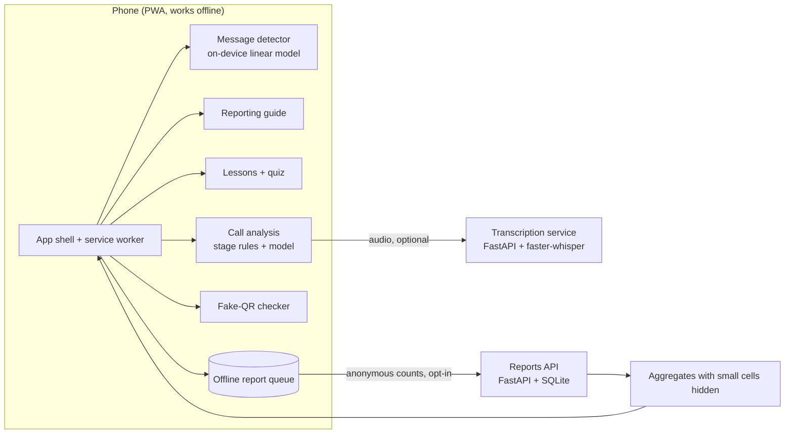

# Suraksha

An installable web app (PWA) that helps first-time digital payment users in Chhattisgarh spot scam messages and calls, report fraud through the right official channel, and learn payment safety in Hindi, Chhattisgarhi and English. Most of it works with no internet.

Built for Hack-a-Sol 5.0, GovTech & Impact track, problem statement GT-02.

## Who it is for

A first-time smartphone payments user in a rural or semi-urban household, comfortable in Hindi or Chhattisgarhi, on a mid-range Android phone with patchy data, who is targeted by OTP scams, fake KYC messages, fake QR codes and calls from "bank staff", "police" or "customs". A second user is a district bank or administration analyst who needs to see which scams are spreading where.

## What it does

| Module | What you get | Works offline |
|---|---|---|
| Check a message | Paste an SMS, WhatsApp text or link. Verdict (likely scam / suspicious / looks genuine), highlighted words, plain-language reasons, next steps. English, Hindi, Hinglish. | Yes |
| Check a call | Transcript analysis for fake KYC, digital arrest, fake courier/customs, electricity and lottery scripts, with the phrases heard and when. Paste text, example calls, or upload / record audio. | Paste and examples: yes. Audio to text: needs internet |
| Report a scam | Two questions, then 1930 helpline, cybercrime.gov.in or Chakshu (Sanchar Saathi), an evidence checklist and a copyable summary. **Complaint helper:** paste the scam message or the bank's payment SMS and it finds the amount, transaction number, UPI id, phone and date; it builds a plan for this case (1930 first, what to block or uninstall), a "say this on the 1930 call" sheet, and a complaint written in English for the cybercrime website, with a copy button for the whole text, a short version and each box. Everything stays on the phone. | Yes (opening a portal needs internet) |
| Learn and quiz | 10 short lessons as swipeable cards, with audio from the lesson recordings or the phone's own voice, 150 questions, a Digital Financial Literacy Score and the weakest topic to study next. Hindi, Chhattisgarhi, English. | Yes |
| Scam trends | Anonymous, opt-in counts by district and scam type, charts with table alternatives, new-scam alerts. | Last saved copy |
| Check a QR | Reads a QR code, shows the UPI payee and amount, flags risky structure. Never says a code is "safe". | Yes |
| On a call right now? | One-tap card with what to do while a suspicious caller is on the line. | Yes |

## Architecture



Everything that can run on the phone does. Message text never leaves the phone. Audio goes to the transcription service only when the user chooses it and is deleted right after. Only opted-in anonymous counts (scam type, channel, district, risk level, the hour) reach the reports API.

## Repository layout

| Path | Contents |
|---|---|
| `apps/web` | The PWA: `src/shell`, `detector`, `call`, `report`, `learn`, `dashboard`, `qr`; model and content in `public/` |
| `services/api` | Anonymous reports API and trends |
| `services/asr` | Speech-to-text service for the call screen |
| `ml` | Training, evaluation, export and parity pipeline for the on-device model |
| `data` | Data cards (`DATA.md`) and team-written messages |
| `docs` | Evaluation report, scoring design, architecture notes, test plan |
| `ai tuning` | Model experiments (larger models, ablations, GPU fine-tuning) |

## Run it

On Windows, double-click `start-all.bat`: it seeds labelled demo data, starts the reports API (port 8000), optionally the transcription service (8001), builds and serves the web app (http://localhost:4173) and opens the browser. `stop-all.bat` closes everything. Or run the pieces by hand:

```bash
# web app
cd apps/web
npm install
npm run dev                 # http://localhost:5173
npm test                    # unit + parity tests
npm run build               # production build with service worker

# reports API (optional, powers the trends screen)
cd services/api
pip install -r requirements.txt
python -m app.seed          # labelled demo data
API_SECRET=change-me uvicorn app.main:app --port 8000

# transcription service (optional, powers audio upload)
cd services/asr
pip install -r requirements.txt
uvicorn app.main:app --port 8001
```

Point the app at the services with `VITE_API_BASE=http://localhost:8000` and `VITE_ASR_BASE=http://localhost:8001` (public values only, no secrets). Tests: `python -m pytest -q` inside `services/api` and `services/asr`.

## Evaluation

The message model (`2026-11-24.1`) is a regularised logistic regression on character and word n-grams plus 26 interpretable warning signals, calibrated, 1.6 MB, scored by TypeScript on the phone. A parity test checks 247 saved examples against the Python scorer (identical tokens and signals, probabilities within 1e-6). The warning bands start at a calibrated probability of 0.14 (suspicious, shown amber) and 0.61 (likely scam, shown red); red is kept for messages the model is sure about, so an app that notifies the user should notify on red and only list amber. What changed since `2026-11-23.3` (which was trained on 1,184 messages by mistake) and what is not yet measured is in [docs/model_2026-11-24.1.md](docs/model_2026-11-24.1.md).

| Set | Messages | `2026-11-23.3` (earlier) | `2026-11-24.1` (this model) |
|---|---|---|---|
| Probe set written by others, never trained on | 780 | scams caught 387 of 399; genuine flagged 25 of 381 (flattered by a leak) | scams caught 387 of 399; genuine flagged 16 of 381 |
| `blind_v1`, clean since the leak guard | 150 | 75 of 75 caught; 1 of 75 flagged (flattered by the leak) | 75 of 75 caught; 1 of 75 flagged |
| Genuine OTP / verification messages | 18 | 0 flagged | 0 flagged |
| Spoken-clip texts as speech-to-text heard them | 40 | scams caught 19 of 22; genuine flagged 0 of 18 | scams caught **15 of 22**; genuine flagged 0 of 18 |
| Hindi / Hinglish spoken-clip texts | 24 | 12 of 12 caught; 1 of 12 flagged | 12 of 12 caught; 0 of 12 flagged |
| Adversarial rewrites of scams (all scams) | 274 | caught 120 | caught 274 (the new text cleaning undoes most of the tricks; recall only, no false-alarm information) |
| Hand-written challenge set, p >= 0.5 | 160 | precision / recall / F1 0.984 / 0.787 / 0.875 | 1.000 / 0.963 / 0.981 (**no longer independent**, see below) |
| Group-aware test split (templated, optimistic) | 3,699 | not comparable (202 messages) | 0.994 / 0.959 / 0.976 at p >= 0.5; 0.987 / 0.989 / 0.988 at the app's warning cut |

"Caught" means shown as suspicious or likely scam; "flagged" is the same for genuine messages. The keyword-only baseline scores F1 0.222 on the challenge set. **Read these numbers with care.** The challenge set was written by the model's authors and inspected during development, and its confident misses were visible when the `2026-11-24.1` signals and data were written, so its 0.963 is no longer an independent test; the probe, blind and clip sets were written by other people and never trained on, and are the more honest numbers. The spoken-clip result is four scams lower than the earlier model on a small set (22 scams, a wide interval); this number comes from the message model alone, and the call screen also applies its call-script rules. The frozen evaluation sets have been scored four times in total (three for earlier candidates, once for this model with the owner's approval). Development sets used to build the model are in `ml/dev` and are not independent tests. Per-language results, bias checks and calibration are in [docs/evaluation_report.md](docs/evaluation_report.md).

## Limitations

- Test-split scores on the public datasets are optimistic because that data is templated English. The challenge set was written by the model's authors and is no longer independent (see the Evaluation section). Scammers who disguise their wording can still get through: the development rewrite set catches 94% of rewritten scams, not all of them.
- Hindi (Devanagari) training data is small (about 900 corpus rows, all team-written); Hindi recall on the challenge set is 0.92 on 26 scams, a wide interval.
- Call analysis supports Hindi and Hinglish only. There is no speech recognition for Chhattisgarhi, and audio transcription needs a connection.
- Live detection during a call is not possible in a web app: phone systems do not let browsers hear a call in progress. The "On a call right now?" card is the substitute.
- Scammers change wording; the model reflects its training data only. No check is perfect, and the app never calls anything "safe".
- The trends screen is indicative, not official statistics. Demo data is always labelled.
- The app does not file complaints and cannot recover money.
- Chhattisgarhi text uses working translations that need confirmation by a native speaker.

## Privacy and security

- Consent to share anonymous counts is off by default and can be switched off at any time; switching it off discards anything queued.
- Reports hold four fixed fields and the hour. A unit test proves message text cannot enter a report, and an API test proves the public interface cannot read raw rows.
- Groups with fewer than 5 reports are hidden before data leaves the server.
- Rate limiting uses a token hashed with a daily salt. No accounts, no device identifiers, no location.
- All text is rendered as plain text; a strict content security policy ships with the hosting configuration.

## Data, models and credits

Public datasets (downloaded from Hugging Face; licences are not stated on the dataset pages, so they are used for local training only and are not redistributed here): [Shade63/scam-classification-multiclass](https://huggingface.co/datasets/Shade63/scam-classification-multiclass), [CloveAI/india-spam-sms](https://huggingface.co/datasets/CloveAI/india-spam-sms), [bolewara/hinglish-scam-text-dataset](https://huggingface.co/datasets/bolewara/hinglish-scam-text-dataset), [ysangam/Indian_Cyber_Scam_PhoneCall_Hinglish_Dataset](https://huggingface.co/datasets/ysangam/Indian_Cyber_Scam_PhoneCall_Hinglish_Dataset). Full data cards: [data/DATA.md](data/DATA.md).

Pre-trained models: [intfloat/multilingual-e5-small](https://huggingface.co/intfloat/multilingual-e5-small) (experiments), [Helsinki-NLP/opus-mt-en-hi](https://huggingface.co/Helsinki-NLP/opus-mt-en-hi) (augmentation experiments), Whisper small (OpenAI, MIT licence) through [faster-whisper](https://github.com/SYSTRAN/faster-whisper) (MIT) and CTranslate2 (MIT) for call transcription, and [vasista22/whisper-hindi-small](https://huggingface.co/vasista22/whisper-hindi-small) (Apache-2.0, a Hindi fine-tune of Whisper small) for Hindi speech; the converted copy is built locally with `services/asr/convert_model.py` and is not stored in this repository.

Lesson video narration is a placeholder computer voice made with the unofficial Google Translate text-to-speech endpoint (no stated licence; Hindi voice used for Chhattisgarhi); native-speaker recordings are planned, see [docs/lesson_audio.md](docs/lesson_audio.md).

Libraries: React, Vite, Tailwind CSS, Recharts, jsQR, vite-plugin-pwa, Noto Sans Devanagari (OFL), FastAPI, scikit-learn, PyTorch, Hugging Face Transformers.

Official channels shown in the app: National Cyber Crime Helpline 1930, [cybercrime.gov.in](https://cybercrime.gov.in), [Chakshu on Sanchar Saathi](https://sancharsaathi.gov.in/sfc/)...

## AI tools

Claude Code (Anthropic) was used for code, tests and data generation under the team's direction; details in [docs/ai_usage.md](docs/ai_usage.md).
