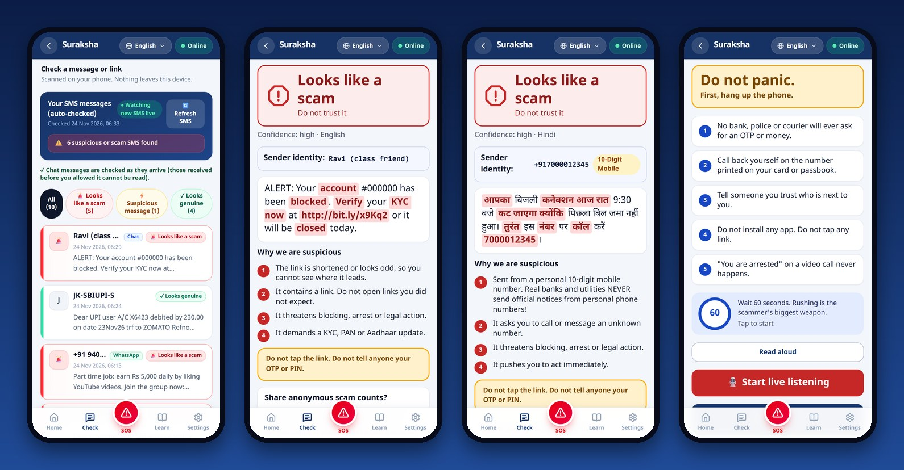
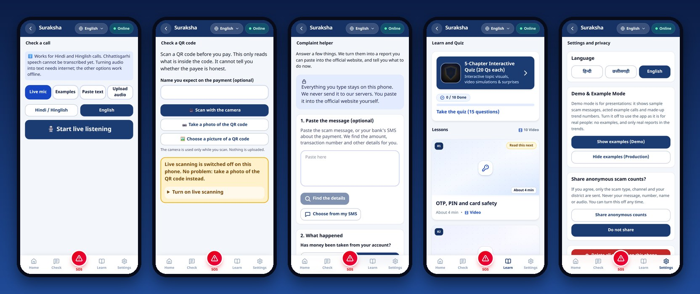
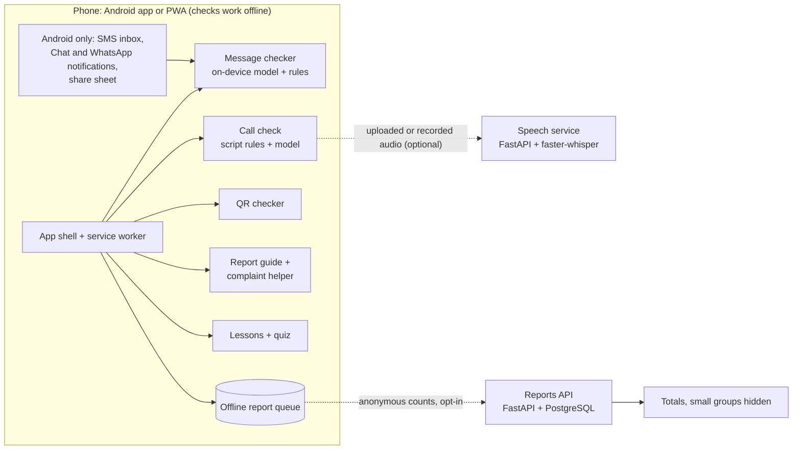

# Suraksha (सुरक्षा)

**A scam shield for first-time UPI users: check a message, call or QR code before you act, in Hindi, Chhattisgarhi or English, mostly without internet.**

🏆 Winning project at **Hack-a-Sol 5.0** · GovTech & Impact track · problem statement **GT-02** · Team Specter




*Screens from the Android build, captured in a test harness with invented sample messages.*

| | |
|---|---|
| **Web app (PWA)** | https://hack-a-sol-specter.vercel.app |
| **Android app (APK)** | https://hack-a-sol-specter.vercel.app/suraksha.apk (read [before you install](#before-you-install-the-apk)) |
| **Full install guide** | [docs/INSTALL.md](docs/INSTALL.md) |
| **All documents** | [docs/README.md](docs/README.md) |

## What it does

| Module | What you get | Works offline |
|---|---|---|
| **Check a message** | Paste an SMS, WhatsApp text or link. Verdict (likely scam / suspicious / looks genuine), highlighted words, plain-language reasons and next steps. English, Hindi, Hinglish | Yes |
| **Check a call** | Fake KYC, digital arrest, courier/customs, electricity and lottery scripts, with the phrases heard and when. Paste text, example calls, live listening, or upload/record audio | Paste and examples: yes. Speech to text: needs internet unless the phone has an offline language pack (live listening only) |
| **Check a QR** | Shows the UPI payee and amount and flags risky structure. Never calls a code "safe" | Yes |
| **On a call right now?** | One tap to a card of what to do while a suspicious caller is on the line | Yes |
| **Report a scam** | Two questions, then 1930, cybercrime.gov.in or Chakshu (Sanchar Saathi), an evidence checklist and a copyable summary | Yes (opening a portal needs internet) |
| **Complaint helper** | Paste the scam message or the bank's payment SMS; it finds the amount, transaction number, UPI id, phone and date, builds a plan and writes a complaint ready to copy. Stays on the phone | Yes |
| **Learn and quiz** | 10 short lessons with cards, audio and video, 150 questions, a chapter quiz with stars and a Digital Financial Literacy Score | Yes |
| **Scam trends** | Anonymous, opt-in counts by district and scam type, with new-scam alerts | Last saved copy |



### Extra on Android

- **Checks the SMS inbox automatically.** New SMS are caught live, the inbox is re-read every 8 seconds while open and when you return to the app, and the phone vibrates for a new warning.
- **Checks Chat (RCS) and WhatsApp messages as they arrive**, only if you switch on Notification access. Messages that arrived earlier cannot be read. The last 60 are kept in a private file on the phone and are never uploaded.
- **Accepts text shared from any app** through the Android share sheet.
- **Shows Online or Offline from a real network check.**

## Before you install the APK

> [!WARNING]
> **Google Play Protect blocks this APK. To install it you have to turn Play Protect scanning off for the install, then turn it back on.** Play Protect [blocks apps installed from a browser, messaging app or file manager](https://developers.google.com/android/play-protect/warning-dev-guidance) when they ask to read SMS or notifications, and Suraksha asks for both because that is how it checks your messages.
>
> - **Turning it off lowers your phone's protection while it is off.** Install only Suraksha, only from this repository or the project website, and switch Play Protect back on straight away.
> - **Never turn it off because a caller, a message or a stranger asked you to.** That is a common scam step.
> - **Rather not?** Use the [web app](https://hack-a-sol-specter.vercel.app). It does everything except check your inbox automatically, and nothing needs to be turned off.

> [!IMPORTANT]
> - This is a **hackathon prototype**, not a certified security product. A "looks genuine" result is not a guarantee. Never share an OTP or PIN, whatever the app says.
> - It is **not on the Play Store**. Download it only from this repository or the project website, and [check the file](#check-the-file-you-downloaded).
> - It is signed with a **hackathon key that is public in this repository**, so a signature match alone does not prove who built a file you got elsewhere.
> - From 2027, Android's [developer verification](https://developer.android.com/developer-verification/guides/faq) means apps from unverified developers, like this one, can be installed only through Android's "advanced flow" (which has a one-day wait to set up) or with ADB.

### Install steps

**Web app (Android, iPhone, computer)**: open https://hack-a-sol-specter.vercel.app and choose *Install app* or *Add to Home screen* (on iPhone: Safari → Share → Add to Home Screen). After one visit the checks, lessons and quiz work offline.

**Android app** (Android 7.0 or newer, about 15.7 MB):

1. Download [`suraksha.apk`](https://hack-a-sol-specter.vercel.app/suraksha.apk) on the phone.
2. **Turn Play Protect scanning off:** open the **Play Store** → your **profile icon** → **Play Protect** → **Settings** (gear) → switch off **Scan apps with Play Protect** ([Google's steps](https://support.google.com/android/answer/2812853); names vary a little between phones).
3. Open the downloaded file. Android asks you to allow **Install unknown apps** for your browser or file manager. Allow it, then install.
4. **Turn Play Protect back on** in the same place, and switch **Install unknown apps** off again. Do this before anything else.
5. Open Suraksha, choose a language, tap **Check** and allow **SMS** access if you want the inbox checked. The app also works without it.
6. Optional: to check Chat and WhatsApp, switch on **Notification access** when the app offers it. If the switch is greyed out, open **Settings → Apps → Suraksha → ⋮ → Allow restricted settings** ([Android help](https://support.google.com/android/answer/12623953)), then try again. Allow restricted settings only for apps you trust.

Play Protect may warn about Suraksha again after you switch it back on, for the same reason. If your phone will not let you turn it off (for example, with Google's Advanced Protection), use the web app.

| Permission | Why the app asks | Needed? |
|---|---|---|
| Read and receive SMS | Check the inbox and new SMS. Text is scored on the phone | Only for the inbox |
| Notification access (Android settings) | Check Chat (RCS) and WhatsApp messages. It reads only messaging apps' notifications | Optional |
| Camera | Scan a QR code, only while scanning | Only for scanning |
| Microphone | Live listening and recording on the call screen | Only for calls |
| Notifications | Warn you about a new risky message | Optional |
| Internet and network state | Official links, trends, speech service, and knowing when you are offline | Yes |

#### Check the file you downloaded

The APK published with this version has this SHA-256:

```
3281f2cfdbb3056dbf7d376b126f0d96fc3abf945af6a0b2badee004a1e5288f
```

On Windows: `Get-FileHash suraksha.apk -Algorithm SHA256`. On macOS or Linux: `shasum -a 256 suraksha.apk`. Signing certificate SHA-256: `48aacc4179e159672102389b60cf974971ac844b23d5b48f1d20d97202135481`.

## How it works



1. **Clean the text**, so spaced-out letters, look-alike characters and mixed Hindi/Latin spellings cannot hide words.
2. **Score it** with a small logistic-regression model (character and word patterns plus 26 named warning signals, 1.6 MB) that runs in TypeScript on the phone.
3. **Apply rules** for links, scam-call scripts and genuine notices (an OTP message that says "do not share" stays genuine).
4. **Show a colour and the reasons.** Amber means "check before acting" (score from 0.14), red means "likely scam" (from 0.61).

Training is in Python (`ml/`). Parity tests fail the build if Python and TypeScript ever disagree.

## Accuracy

| Test (the model never trained on these) | Scams caught | Genuine messages flagged |
|---|---|---|
| Probe set written by others, 780 messages | 387 of 399 | 16 of 381 |
| Blind set, 150 messages | 75 of 75 | 1 of 75 |
| Spoken-call texts, message model alone | **15 of 22** (our weakest result) | 0 of 18 |
| Final model on the held-out test split, 3,744 messages | 1,425 of 1,439 (99.0%) | 38 of 2,305 (1.6%) |

The first three rows describe the **first build** of model `2026-11-24.1`; the frozen sets were **not scored again** after the model was updated. Read all of these as optimistic.

<details>
<summary><b>Full evaluation table and how to read it</b></summary>

The message model (`2026-11-24.1`) is a regularised logistic regression on character and word n-grams plus 26 interpretable warning signals, calibrated, 1.6 MB. A parity test checks 247 saved examples against the Python scorer (identical tokens and signals, probabilities within 1e-6). What changed since `2026-11-23.3` (which was trained on 1,184 messages by mistake) is in [docs/model_2026-11-24.1.md](docs/model_2026-11-24.1.md).

**Which build these numbers describe.** The table below was measured once, on the first build of `2026-11-24.1` (warning cuts 0.18 / 0.54, 19,448 training messages). A live test on a phone then showed genuine Jio missed-call alerts and plan offers shown as scams, so the model was retrained (19,705 messages, cuts 0.14 / 0.61). On the group-aware test split the final model catches 1,425 of 1,439 scams at the app's warning cut (99.0%, unchanged) but flags 38 of 2,305 genuine messages (1.6%, up from 19 of 2,260, 0.8%), and shows 1,199 of 1,439 scams in red (83%, down from 1,332, 93%). On two small development sets written for the problem cases, genuine call messages shown red fell from 11 of 12 to 0 and genuine promotions from 3 of 12 to 0, with every scam in them still red.

| Set | Messages | `2026-11-23.3` (earlier) | `2026-11-24.1` (first build) |
|---|---|---|---|
| Probe set written by others, never trained on | 780 | scams caught 387 of 399; genuine flagged 25 of 381 (flattered by a leak) | scams caught 387 of 399; genuine flagged 16 of 381 |
| `blind_v1`, clean since the leak guard | 150 | 75 of 75 caught; 1 of 75 flagged (flattered by the leak) | 75 of 75 caught; 1 of 75 flagged |
| Genuine OTP / verification messages | 18 | 0 flagged | 0 flagged |
| Spoken-clip texts as speech-to-text heard them | 40 | scams caught 19 of 22; genuine flagged 0 of 18 | scams caught **15 of 22**; genuine flagged 0 of 18 |
| Hindi / Hinglish spoken-clip texts | 24 | 12 of 12 caught; 1 of 12 flagged | 12 of 12 caught; 0 of 12 flagged |
| Adversarial rewrites of scams (all scams) | 274 | caught 120 | caught 274 (recall only, no false-alarm information) |
| Hand-written challenge set, p >= 0.5 | 160 | precision / recall / F1 0.984 / 0.787 / 0.875 | 1.000 / 0.963 / 0.981 (**no longer independent**) |
| Group-aware test split (templated, optimistic) | 3,699 | not comparable (202 messages) | 0.994 / 0.959 / 0.976 at p >= 0.5; 0.987 / 0.989 / 0.988 at the app's warning cut |

"Caught" means shown as suspicious or likely scam; "flagged" is the same for genuine messages. A keyword-only baseline scores F1 0.222 on the challenge set. The challenge set was written by the model's authors and inspected during development, so it is no longer an independent test; the probe, blind and clip sets were written by other people and are the more honest numbers. The spoken-clip result is four scams lower than the earlier model on a small set (a wide interval); it comes from the message model alone, and the call screen also applies its call-script rules. The frozen sets have been scored four times in total (three for earlier candidates, once for this model with the owner's approval). Development sets in `ml/dev` are not independent tests. Per-language results, bias checks and calibration: [docs/evaluation_report.md](docs/evaluation_report.md).

</details>

## Privacy and security

- **Message text is checked on the phone** and is not uploaded.
- **Call audio:** live listening uses the phone's own speech recogniser (usually Google's), which may send audio to its provider unless an offline language pack is available. Audio you upload or record goes to our speech service only when you choose it, and is deleted right after.
- **Anonymous counts are off by default.** If you agree, only scam type, channel, district, risk level and the hour are sent. A unit test proves message text cannot enter a report, an API test proves raw rows cannot be read, and groups with fewer than 5 reports are hidden. Switching consent off discards anything queued.
- **No accounts, no device identifiers, no location.**
- **Rate limits:** 60 reports per hour per anonymous token (hashed with a daily salt); the speech service allows 20 clips per hour per client. Nothing detects coordinated abuse yet.
- **On Android,** the Chat and WhatsApp reader keeps the last 60 messages in a private file that is excluded from backups.
- All text is shown as plain text, and the website ships a content security policy.

## Repository map

| Path | Contents |
|---|---|
| [`apps/web`](apps/web) | The app: `src/shell`, `detector`, `verdict`, `call`, `report`, `learn`, `dashboard`, `qr`; model and content in `public/` |
| [`apps/web/android`](apps/web/android) | Capacitor Android project: SMS reader, Chat and WhatsApp notification listener, share intent, release signing |
| [`services/api`](services/api) | Anonymous reports API and trends |
| [`services/asr`](services/asr) | Speech-to-text service for the call screen |
| [`ml`](ml) | Training, evaluation, export and parity pipeline for the on-device model |
| [`data`](data) | Data cards ([`DATA.md`](data/DATA.md)) and team-written messages |
| [`docs`](docs/README.md) | Install guide, evaluation, architecture, security checklist, test plan and screenshots |
| [`ai tuning`](ai%20tuning) | Model experiments (larger models, ablations, GPU fine-tuning) |

## Run it locally

On Windows, double-click `start-all.bat`: it seeds labelled demo data, starts the reports API (port 8000), optionally the speech service (8001), builds and serves the web app (http://localhost:4173) and opens the browser. `stop-all.bat` closes everything. Or run the pieces by hand:

```bash
# web app
cd apps/web
npm install
npm run dev                 # http://localhost:5173
npm test                    # unit + parity tests
npm run build               # production build with service worker

# Android app (needs JDK 21 and the Android SDK; run the web build first)
npm run android:sync        # copies the web build into the Android project, without the website's own APK
cd android
./gradlew assembleRelease   # writes app/build/outputs/apk/release/app-release.apk
cd ../../..

# reports API (optional, powers the trends screen)
cd services/api
pip install -r requirements.txt
python -m app.seed          # labelled demo data
API_SECRET=change-me uvicorn app.main:app --port 8000

# speech service (optional, powers audio upload), in another terminal
cd services/asr
pip install -r requirements.txt
uvicorn app.main:app --port 8001
```

Use `npm run android:sync`, not a plain `npx cap sync`: a plain sync copies the website's APK inside the new APK and doubles its size. Release builds are signed with `apps/web/release.keystore`, a hackathon key kept in this repository; **create a new key before publishing anywhere.** Point the app at local services with `VITE_API_BASE=http://localhost:8000` and `VITE_ASR_BASE=http://localhost:8001` (public values only, no secrets). Tests: `python -m pytest -q` inside `services/api`, `services/asr` and `ml`.

## Who it is for

A first-time smartphone payments user in a rural or semi-urban household, comfortable in Hindi or Chhattisgarhi, on a mid-range Android phone with patchy data, who is targeted by OTP scams, fake KYC messages, fake QR codes and calls from "bank staff", "police" or "customs". A second user is a district bank or administration analyst who needs to see which scams are spreading where.

## Data, models and credits

Public datasets (from Hugging Face; licences are not stated on the dataset pages, so they are used for local training only and are not redistributed here): [Shade63/scam-classification-multiclass](https://huggingface.co/datasets/Shade63/scam-classification-multiclass), [CloveAI/india-spam-sms](https://huggingface.co/datasets/CloveAI/india-spam-sms), [bolewara/hinglish-scam-text-dataset](https://huggingface.co/datasets/bolewara/hinglish-scam-text-dataset), [ysangam/Indian_Cyber_Scam_PhoneCall_Hinglish_Dataset](https://huggingface.co/datasets/ysangam/Indian_Cyber_Scam_PhoneCall_Hinglish_Dataset). Full data cards: [data/DATA.md](data/DATA.md).

Pre-trained models: [intfloat/multilingual-e5-small](https://huggingface.co/intfloat/multilingual-e5-small) (experiments), [Helsinki-NLP/opus-mt-en-hi](https://huggingface.co/Helsinki-NLP/opus-mt-en-hi) (augmentation experiments), Whisper small (OpenAI, MIT) through [faster-whisper](https://github.com/SYSTRAN/faster-whisper) (MIT) and CTranslate2 (MIT), and [vasista22/whisper-hindi-small](https://huggingface.co/vasista22/whisper-hindi-small) (Apache-2.0) for Hindi speech; the converted copy is built locally with `services/asr/convert_model.py` and is not stored here.

Lesson video narration is a placeholder computer voice made with the unofficial Google Translate text-to-speech endpoint (no stated licence; a Hindi voice is used for Chhattisgarhi); native-speaker recordings are planned, see [docs/lesson_audio.md](docs/lesson_audio.md).

Libraries: React, Vite, Tailwind CSS, Capacitor, @capgo/capacitor-speech-recognition, Recharts, jsQR, vite-plugin-pwa, Noto Sans Devanagari (OFL), FastAPI, scikit-learn, PyTorch, Hugging Face Transformers.

Official channels shown in the app: National Cyber Crime Helpline **1930**, [cybercrime.gov.in](https://cybercrime.gov.in), [Chakshu on Sanchar Saathi](https://sancharsaathi.gov.in/sfc/).

## Team Specter

Nikhil Gavel · Asmita Manral · Damini Divya Sori · Rohan Bhandari

## AI tools and licence

Claude Code (Anthropic) was used for code, tests and data generation under the team's direction; details in [docs/ai_usage.md](docs/ai_usage.md). This repository does not include a licence file yet, so ask the team before reusing the code.
