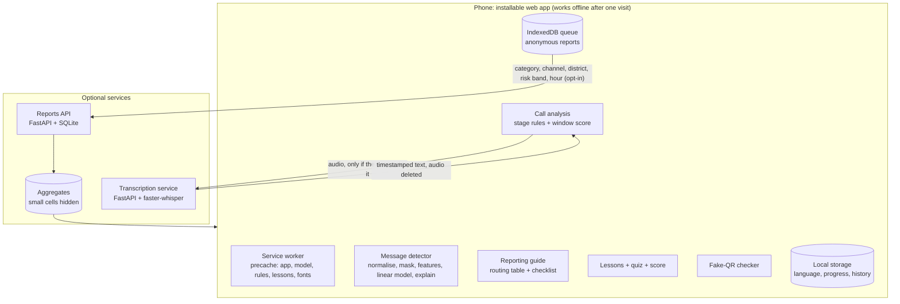

# Architecture

Everything that can run on the phone does. The target users often have weak connectivity and handle private data.

## Components

| Component | Runs on | Responsibility | Needs a network |
|---|---|---|---|
| App shell (`apps/web/src/shell`) | Phone | Install, navigation, language, caching, storage, update handling, report queue | First load and updates only |
| Message detector (`detector`) | Phone | Clean text, signals, score with the exported model, bands, reasons, link checks | No |
| Call screen (`call`) | Phone | Validate and upload audio, match script stages on the transcript, score windows | Only for audio to text |
| Reporting guide (`report`) | Phone | Route to 1930, cybercrime.gov.in or Chakshu, checklist, summary | No (opening a portal needs it) |
| Lessons and quiz (`learn`) | Phone | Lessons, quiz, literacy score | No |
| Trends (`dashboard`) | Phone | Consent, fixed-field reports, queue, charts | To sync and refresh |
| QR checker (`qr`) | Phone | Decode and inspect QR codes | No |
| Transcription service (`services/asr`) | Cloud | Hindi/Hinglish speech to text, deletes the audio | Yes |
| Reports API (`services/api`) | Cloud | Store anonymous reports, serve aggregates and alerts | Yes |
| Training pipeline (`ml`) | Laptop | Data, training, evaluation, export, parity | No |

## Data flows

| Flow | Steps | Where the data stays |
|---|---|---|
| Check a message | clean, mask links/numbers/amounts, features, score, band, reasons | On the phone |
| Check a call | choose a clip, validate, upload, transcribe, audio deleted, text returns, match stages, score windows, verdict | Audio reaches the transcription service only; the transcript stays on the phone |
| Report | answer one or two questions, channel and checklist shown; with consent an anonymous report is queued and synced | Message text and audio are never sent: only category, channel, district, risk band, hour |
| Learn | lesson, quiz, topic scores, literacy score | On the phone |

## Offline behaviour

The service worker precaches the app files, the model, rule lists, lesson and question packs and fonts, each versioned. After one online visit the detector, lessons, quiz, QR checker and reporting guide work with no network. Settings, history, progress and the report queue live in local browser storage. A new version downloads in the background and the user is asked before it is applied; it is never applied during a quiz or a report. Queued reports sync when the connection returns, on the next app open at the latest, and the server de-duplicates them so each is counted once.

Not available offline: the first install, audio to text, fresh trends data, opening official portals.

## The on-device model contract

`ml/train.py` writes `model.json` (features, idf, coefficients, intercept, calibration, band thresholds, signal coefficients) and `signals.json`. The app reads only these files, so a new model needs no code change. `ml/parity.py` writes saved examples; `apps/web/src/detector/parity.test.ts` must reproduce them.

## Privacy by design

| Module | Processed | Retention |
|---|---|---|
| Message check | Pasted text, on the phone | Not stored |
| Call check | Audio sent to the transcription service | Deleted immediately; transcript returned and not stored on the server |
| Reporting | Answers and checklist ticks, on the phone | Until cleared |
| Lessons and quiz | Answers and scores, on the phone | Until cleared |
| Trends reports | Category, channel, district, risk band, hour, only with consent | Raw rows 30 days, then aggregates only |

## Deployment

Static hosting for `apps/web` (Vercel or Netlify, headers in `vercel.json` and `public/_headers`), Docker for `services/api` and `services/asr`. See `deployment.md`.
